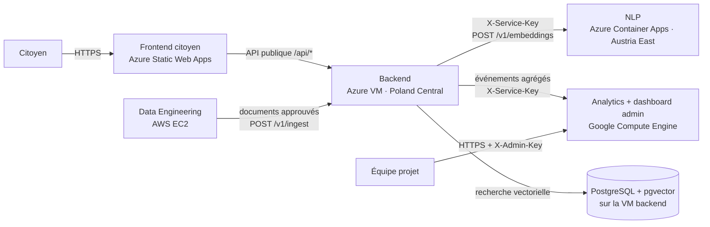
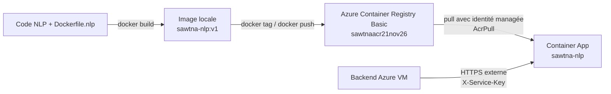
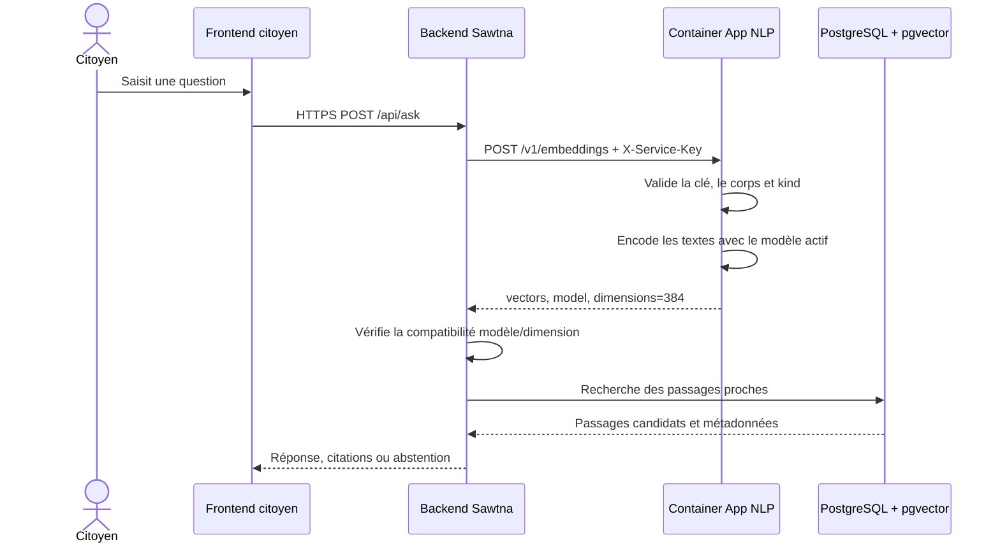

# Rapport technique — Déploiement NLP Azure

**Projet :** Sawtna AI
**Date :** 22 novembre 2026
**Périmètre :** microservice NLP de la Partie 3 et son déploiement Azure Container Apps.

## 1. Résumé

Le service NLP a été conteneurisé, publié dans Azure Container Registry et
déployé dans Azure Container Apps. Les vérifications de santé, d’authentification
et de génération d’embeddings ont réussi.

Le service déployé utilise actuellement `intfloat/multilingual-e5-small` sur CPU
et produit des vecteurs de 384 dimensions. Une communication antérieure de
Soulaymane indique que son backend indexe avec `concept-hash-v1`. Cette différence
de modèle doit être résolue avant de considérer l’intégration complète : deux
modèles peuvent avoir la même dimension tout en produisant des espaces vectoriels
incompatibles.

## 2. Architecture déployée

| Élément | Configuration |
|---|---|
| Groupe de ressources | `sawtna-rg` |
| Région | Austria East (`austriaeast`) |
| Registre | `sawtnaacr21nov26.azurecr.io`, offre Basic |
| Image | `sawtnaacr21nov26.azurecr.io/sawtna-nlp:v1` |
| Empreinte de l’image publiée | `sha256:e4fcbc1e825db872da723af0487c90651a1ee76f1b946611eb309f1ab2b18df7` |
| Environnement Container Apps | `sawtna-aca-env` |
| Application | `sawtna-nlp` |
| URL de service | <https://sawtna-nlp.purplebush-3bda44a9.austriaeast.azurecontainerapps.io> |
| Ingress | Externe, HTTPS, port cible 8000 |
| Ressources par réplique | 1 vCPU, 2 Gio de mémoire |
| Mise à l’échelle | minimum 0, maximum 1 réplique |
| Modèle | `intfloat/multilingual-e5-small`, CPU, 384 dimensions |
| Identité de pull ACR | `sawtna-nlp-acrpull`, rôle `AcrPull` sur le registre |
| Destination de logs de l’environnement | `none` |

### Vue d’ensemble de Sawtna



Le frontend citoyen appelle le backend; il n’appelle jamais directement le NLP.
Le NLP ne reçoit que les textes à vectoriser et ne lit pas la base de données.
Le backend conserve la responsabilité de la recherche RAG, des citations et de
la réponse au frontend. Le dashboard Analytics est une application distincte.

### Chemin de construction et de déploiement du NLP



Le digest publié est `sha256:e4fcbc1e825db872da723af0487c90651a1ee76f1b946611eb309f1ab2b18df7`.
L’identité `sawtna-nlp-acrpull` est autorisée uniquement à tirer l’image depuis
le registre. L’authentification métier des requêtes embeddings reste assurée par
`X-Service-Key`.

L’application utilise une identité managée pour tirer l’image privée. La clé
d’accès NLP est stockée comme secret Container Apps `service-key` et référencée
par `SAWTNA_SERVICE_KEY`. Sa valeur n’est pas incluse dans ce rapport. Une copie
locale est conservée dans `.secrets/sawtna-service-key.txt`; le dossier
`.secrets/` est ignoré par Git.

## 3. Configuration du conteneur

Le conteneur est construit avec `commun/infra/Dockerfile.nlp`. Il configure :

- `SAWTNA_SERVICE=nlp` ;
- `SAWTNA_EMBEDDER=multilingual-e5-small` ;
- `SAWTNA_MODEL_DEVICE=cpu` ;
- port d’écoute `8000`, avec le serveur accessible sur toutes les interfaces ;
- modèle téléchargé et contrôlé durant le build, puis chargé en mode hors ligne
  au démarrage.

Les routes conservent le contrat commun :

- `GET /health` ne demande pas de clé et indique le service, le modèle et la
  dimension ;
- `POST /v1/embeddings` exige `X-Service-Key`, reçoit `texts` et `kind`
  (`query` ou `passage`), et renvoie `vectors`, `model` et `dimensions` ;
- la taille maximale du lot est de 64 textes.

### Schéma de déploiement et variables

| Variable | Valeur / source | Rôle |
|---|---|---|
| `SAWTNA_SERVICE` | `nlp` | Sélectionne l’application NLP au démarrage |
| `SAWTNA_EMBEDDER` | `multilingual-e5-small` | Identifiant de l’encodeur actif |
| `SAWTNA_MODEL_DEVICE` | `cpu` | Exécution CPU dans Container Apps |
| `PORT` | `8000` | Port fourni au serveur du conteneur |
| `SAWTNA_SERVICE_KEY` | Référence Azure `service-key` | Authentifie les appels interservices |
| `HF_HUB_OFFLINE` / `TRANSFORMERS_OFFLINE` | `1` | Empêche le téléchargement du modèle au démarrage |

Le modèle `intfloat/multilingual-e5-small` est téléchargé et contrôlé pendant la
construction de l’image. Le code préfixe chaque texte par `query:` ou `passage:`
selon `kind`, puis normalise les embeddings. Le modèle chargé est mis en cache
dans le processus.

### Contrat API détaillé

La source de vérité est
`commun/packages/contracts/nlp.openapi.json`.

#### `GET /health`

Route publique de santé, sans secret :

```json
{
  "status": "ok",
  "service": "nlp",
  "model": "multilingual-e5-small",
  "dimensions": 384
}
```

#### `POST /v1/embeddings`

Header obligatoire : `X-Service-Key: <clé partagée>`.

Exemple de requête :

```json
{
  "texts": [
    "Comment sont élus les conseils des communes ?",
    "كيف يتم انتخاب مجالس الجماعات؟"
  ],
  "kind": "query"
}
```

`texts` contient de 1 à 64 chaînes. `kind` vaut `query` ou `passage` et prend
`query` par défaut. Les propriétés additionnelles sont refusées par le schéma.

Structure de réponse (vecteurs abrégés pour la lisibilité) :

```json
{
  "vectors": [
    ["valeur flottante 1", "…", "valeur flottante 384"],
    ["valeur flottante 1", "…", "valeur flottante 384"]
  ],
  "model": "intfloat/multilingual-e5-small",
  "dimensions": 384
}
```

Chaque vecteur réel contient exactement 384 valeurs numériques. Le nombre de
vecteurs retournés est égal au nombre de textes reçus.

| Réponse HTTP | Signification |
|---|---|
| `200` | Embeddings retournés selon le schéma |
| `401` | Clé absente ou invalide |
| `422` | Corps invalide ou paramètres hors contrat |

## 4. Vérifications exécutées

| Vérification | Résultat observé |
|---|---|
| Image locale `sawtna-nlp:v1` | Présente, taille Docker `765 137 829` octets |
| Publication dans ACR | Réussie; Docker a retourné le digest indiqué ci-dessus |
| `az acr repository show-tags` | Le tag `v1` apparaît dans le dépôt `sawtna-nlp` |
| `GET /health` sur Container Apps | HTTP 200; modèle `multilingual-e5-small`, dimension 384 |
| `POST /v1/embeddings` avec clé valide | Deux entrées de test (français et arabe), deux vecteurs de 384 dimensions |
| `POST /v1/embeddings` sans clé | HTTP 401, accès refusé comme attendu |
| Configuration de l’application | Provisioning `Succeeded`; ingress externe; référence à un secret pour la clé |

Ces vérifications valident l’image et le service NLP isolé. Elles ne constituent
pas un test d’intégration depuis la VM du backend.

### Séquence d’une requête RAG



Le service NLP ne génère pas la réponse conversationnelle et ne choisit pas les
citations. Il transforme les textes en vecteurs; le backend orchestre la
recherche documentaire et retourne la réponse au frontend.

## 5. Intégration avec le backend

L’URL de staging communiquée par Soulaymane est :

<https://sawtna-api-staging-50fe10.polandcentral.cloudapp.azure.com>

Sa communication indique une disponibilité planifiée du backend de 14 h à 19 h,
heure du Maroc. Lors de notre vérification, `/health` n’a pas répondu dans le
délai imparti; la disponibilité effective de la VM reste donc à confirmer par
son responsable.

Le backend doit, côté serveur :

1. utiliser `SAWTNA_NLP_URL` avec l’URL de la Container App ci-dessus ;
2. utiliser dans `SAWTNA_SERVICE_KEY` la même valeur que le secret `service-key`
   du service NLP ;
3. appeler `POST /v1/embeddings` avec le header `X-Service-Key` et le schéma
   décrit dans `commun/packages/contracts/nlp.openapi.json`.

L’utilisateur a indiqué avoir transmis la nouvelle clé à Soulaymane. Le rapport
ne dispose pas d’une preuve de test de bout en bout depuis le backend.

### Compatibilité du modèle — point bloquant à clarifier

Le message antérieur de Soulaymane demande `concept-hash-v1` et précise que
l’identifiant du modèle doit correspondre à celui des passages déjà indexés.
Le service Azure actuellement déployé utilise `intfloat/multilingual-e5-small`.
La dimension 384 seule ne garantit pas la compatibilité de recherche.

Avant de connecter le backend, Soulaymane et le responsable NLP doivent confirmer
le modèle effectivement utilisé pour l’index courant. Si l’index existant est en
`concept-hash-v1`, il faut soit conserver ce modèle côté service, soit planifier
une réindexation complète avant de basculer vers E5. Aucun changement de modèle
n’est effectué par ce rapport.

## 6. Sécurité et exploitation

- L’ingress est public en HTTPS; `/v1/embeddings` reste protégé par
  `X-Service-Key`. `/health` est public.
- La clé n’est ni dans l’image ni dans Git. Ne pas l’ajouter au frontend.
- L’application peut descendre à zéro réplique; le premier appel après inactivité
  peut subir un démarrage à froid.
- L’environnement n’envoie pas ses logs vers une destination centralisée. Pour
  diagnostiquer les erreurs après déploiement, consulter les journaux de
  Container Apps ou configurer une destination de logs adaptée.
- L’ACR Basic reste actif et peut entraîner des frais tant qu’il existe.

## 7. Commandes de vérification

Depuis la racine du dépôt, une fois Azure CLI connecté :

```powershell
az acr repository show-tags --name sawtnaacr21nov26 --repository sawtna-nlp --output table
az containerapp show --name sawtna-nlp --resource-group sawtna-rg --query "{state:properties.provisioningState,fqdn:properties.configuration.ingress.fqdn}" --output json
Invoke-RestMethod 'https://sawtna-nlp.purplebush-3bda44a9.austriaeast.azurecontainerapps.io/health'
```

## 8. Captures d’écran à ajouter

Les captures ne sont pas encore incluses. Elles pourront être ajoutées ici dès
qu’elles seront fournies; aucune capture illustrative n’a été fabriquée.

| Capture attendue | Élément à documenter | Précaution |
|---|---|---|
| ACR, dépôt `sawtna-nlp` | Présence du tag `v1` et, si affiché, son digest | Masquer toute donnée de compte non nécessaire |
| Container App `sawtna-nlp` | État, FQDN et région | Ne pas afficher la valeur d’un secret |
| Configuration Container Apps | Ingress, port, CPU/RAM et mise à l’échelle | Masquer les valeurs secrètes; laisser visibles les noms de références |
| Test `/health` | Réponse HTTP et nom du modèle | Aucun secret attendu |
| Test embeddings | Statut, nom du modèle et dimension retournée | Masquer le header `X-Service-Key` |
| Backend staging (facultatif) | URL active et contrôle de santé pendant sa plage de fonctionnement | Masquer les clés et identifiants |

## 9. Fichiers concernés

- `commun/infra/Dockerfile.nlp` — construction du conteneur NLP ;
- `.dockerignore` — exclusion des fichiers inutiles et secrets du contexte Docker ;
- `.gitignore` — exclusion de `.secrets/` ;
- `commun/docs/deployment/azure-container-apps.md` — configuration et procédure
  de déploiement courante ;
- le présent rapport.

Le code du backend de Soulaymane n’a pas été modifié dans le cadre de ce
déploiement NLP.
