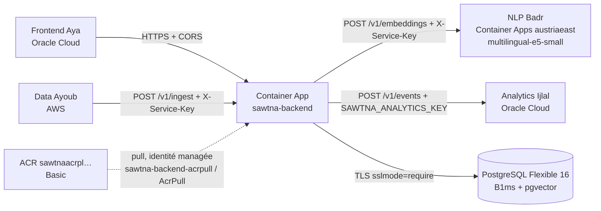

# Backend Sawtna sur Azure, sans VM (Container Apps + PostgreSQL Flexible)

Partie 2 (Soulaymane). Ce dossier remplace `../deploy/`, qui reposait sur une VM (IaaS), Docker Compose, Caddy et un arrêt programmé par systemd.
Mis en service le 23/11/2026. Depuis le 24/11/2026, `/health` répond `"status": "ok"` : PostgreSQL + pgvector, NLP E5 de Badr et Analytics d'Ijlal joignables, 2 documents et 7 passages indexés avec `multilingual-e5-small`.

## Architecture



| Ressource | Nom | Région |
|---|---|---|
| Groupe de ressources | `rg-sawtna-backend-paas` | austriaeast (métadonnées seulement) |
| Registre | `sawtnaacrpl59623c` (Basic) | polandcentral |
| PostgreSQL Flexible | `sawtna-pg-pl-384db6`, Burstable B1ms, v16, 32 Go, base `sawtna` | polandcentral |
| Environnement Container Apps | `sawtna-backend-env` (Consumption, express) | polandcentral |
| API | `sawtna-backend` : 0,5 vCPU / 1 Gio, 0 à 1 réplique | polandcentral |
| Ancien NLP (secours, inutilisé) | `sawtna-nlp-hash` (`concept-hash-v1`) : 0,25 vCPU / 0,5 Gio, 0 réplique | polandcentral |
| Identité managée | `sawtna-backend-acrpull` (rôle AcrPull sur le registre) | polandcentral |

URL de l'API : `https://sawtna-backend.victorioussand-15a060a5.polandcentral.azurecontainerapps.io`

| Avant (VM, IaaS) | Maintenant (PaaS / serverless) |
|---|---|
| `vm-sawtna-backend` + Docker Compose | Azure Container Apps (aucun serveur à gérer) |
| Conteneur `pgvector/pgvector:pg16` | Azure Database for PostgreSQL – Flexible Server + extension `vector` |
| Caddy + Let's Encrypt | HTTPS et certificat fournis par Container Apps |
| Timer systemd + Logic App (20 h) | Passage automatique à 0 réplique ; `stop-start.sh` pour la base |
| Scripts de sauvegarde maison | Sauvegardes automatiques (7 jours) avec restauration à un instant donné |
| `.secrets/staging.env` sur la VM | Secrets Container Apps (`secretref:`), jamais dans l'image |

## Déploiement

Prérequis : Git Bash, Azure CLI connecté (`az login`), Docker Desktop démarré, venv `.venv` à la racine du dépôt.

```bash
cd partie-2-backend/deploy-paas
./01-provision.sh                       # RG, ACR, PostgreSQL (+VECTOR, pare-feu), environnement ACA
./02-build-push.sh                      # build local (Dockerfile.paas) puis push vers l'ACR
./03-deploy-apps.sh                     # identité AcrPull, (NLP interne si NLP_MODE=internal), backend
./04-verify.sh --ingest chemin/lot.jsonl  # /health, /api/documents, vérification (verify_lot.py) + ingestion
```

Tous les scripts peuvent être relancés. Pour une nouvelle version du code, relancer `02` puis `03`.
Au premier lancement, `_common.sh` crée `.secrets/paas.env` : il y met le mot de passe PostgreSQL et les noms, et reprend les clés de l'ancien staging.

## Contraintes Azure for Students rencontrées (et contournements)

| Problème | Contournement |
|---|---|
| Régions limitées par une stratégie (france/poland/belgium central, austriaeast, italynorth) | Tout est en polandcentral |
| PostgreSQL B1ms refusé en austriaeast (`SkuNotAvailable`) | Base en polandcentral |
| ACR Tasks interdit (`TasksOperationsNotAllowed`), donc pas de `az acr build` | Build local avec Docker, puis push |
| Envoi de la couche pip de ~200 Mo qui expire | `Dockerfile.paas` découpe les dépendances en plusieurs couches ; pip et push réessaient |
| Environnement « express » : identité managée système refusée | Identité utilisateur `sawtna-backend-acrpull` |
| Environnement « express » : l'ingress interne répond 404, même aux autres apps | NLP en ingress externe, protégé par `X-Service-Key` (401 sans clé) |

## Coûts et arrêt

- Container Apps : 0 réplique au repos. Rien n'est facturé tant que l'API n'est pas appelée ; le premier appel subit un démarrage à froid.
- PostgreSQL B1ms : seul poste facturé en continu. `./stop-start.sh stop` l'arrête, `./stop-start.sh start` le relance, `./stop-start.sh status` affiche l'état. Azure le redémarre de lui-même après 7 jours d'arrêt.
- ACR Basic : environ 5 $/mois.

## Choix du NLP

`NLP_MODE` se règle dans `config.env` :
- `shared` (actuel, depuis le 24/11/2026) : NLP E5 de Badr (`SHARED_NLP_URL`). `SAWTNA_SERVICE_KEY` = son secret `service-key`. Changer de modèle impose de réindexer : les passages, renvoyés avec le même identifiant, sont remplacés.
- `internal` : NLP `concept-hash-v1` déployé dans ce groupe de ressources (comportement de la VM), gardé en secours.

## Analytics

`SAWTNA_ANALYTICS_URL` (dans `config.env`) pointe vers l'Analytics d'Ijlal. Sa clé est un secret séparé, `analytics-key` (variable `SAWTNA_ANALYTICS_KEY`), distinct de la clé du NLP ; sans elle, le backend utilise `SAWTNA_SERVICE_KEY`. `GET /api/admin/summary` lit son `/v1/summary`.

## Sécurité

- PostgreSQL : point d'accès public filtré par la règle de pare-feu `0.0.0.0` (services Azure uniquement, aucune IP Internet), TLS obligatoire, mot de passe aléatoire stocké en secret.
- Les secrets (URL de la base, clés) sont des secrets Container Apps, et ne figurent ni dans l'image ni dans Git (`.secrets/` est ignoré).
- Le registre est privé, et l'image est tirée par une identité managée qui n'a que le rôle AcrPull.
- Le NLP est public, mais `/v1/embeddings` exige `X-Service-Key`. `/health` est public.
- Limite connue : la règle « services Azure » ouvre la base à toutes les IP Azure. L'étape suivante serait un environnement Container Apps en VNet avec un endpoint privé pour la base (plus cher, hors mode express).

## Après validation

1. Faire les captures pour la section 9 : portail (groupe de ressources, Container App, serveur PostgreSQL), `/health` et `/api/documents`.
2. Lancer `./99-supprimer-ancienne-vm.sh` : le script vérifie que le PaaS répond, puis demande de taper `SUPPRIMER`.
3. Quand le lot nettoyé d'Ayoub arrive : `./04-verify.sh --ingest chemin/du/lot.jsonl`, puis retirer l'ancien passage `eecae5d46f2e…` (route `POST /api/admin/passages/{id}/retire`).
