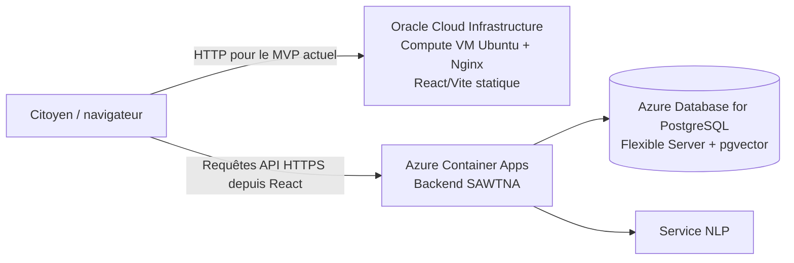

# SAWTNA — Interface citoyenne

**Responsable :** Aya Sdour · **Partie 4** · React / Vite / **Oracle Cloud Infrastructure (Compute VM — IaaS)**.

SAWTNA aide à comprendre les institutions et le vote au Maroc à partir du corpus disponible. Projet étudiant indépendant, sans affiliation politique. L’interface ne recommande aucun candidat et ne remplace pas les informations officielles à jour.

## Trois espaces

- **Assistant** : questions indépendantes, réponses extractives du backend, passages cités dans leur langue originale, liens documentaires contrôlés, abstention explicite lorsque le corpus est insuffisant. Aucune génération externe ni historique de conversation.
- **Bibliothèque** : catalogue des documents indexés, recherche locale par titre, identifiant et langue, filtres par langues effectivement présentes. Le compteur de passages suit les résultats filtrés. Les titres, passages, langues et statuts viennent du backend ; un identifiant reste affichable lorsque les métadonnées sont absentes.
- **Quiz** : questions et options reçues du serveur, choix radio natifs, progression, soumission de toutes les réponses, résultat et corrections calculés exclusivement côté backend. Un échec de soumission conserve les choix.

**État constaté au 24 novembre 2026 :** les trois parcours ont été testés manuellement sur le frontend Oracle avec le backend Azure, y compris la soumission du quiz. Ces constats ne remplacent pas une campagne de tests exhaustive.

## Architecture conservée et hébergement effectif

React 19, React DOM, Vite 7, plugin React et Lucide ; Playwright pour le navigateur. Versions exactes verrouillées dans `package-lock.json`. Aucune nouvelle dépendance ajoutée pour le changement d’hébergement.

- `src/main.jsx` : point d’entrée, navigation par ancres `#assistant`, `#library`, `#quiz`, composants existants et dictionnaire initial.
- `src/interface-copy.js` : libellés complémentaires et messages d’erreur localisés.
- `src/api.js` : fetch public, URL de base, timeout de 65 secondes, annulation, validation des réponses et liens HTTP(S).
- `src/styles.css` : CSS natif consolidé, identité blanc/gris/rouge, tailles lisibles et propriétés logiques RTL.

Aucun routeur supplémentaire. Retour/précédent utilise l’historique des ancres. La langue est conservée pendant la navigation et dans le stockage local lorsque disponible. La navigation vers un autre espace réinitialise son état temporaire, comme auparavant. Un changement de langue réinitialise le quiz et l’assistant et annule leurs requêtes en cours pour éviter un résultat dans la mauvaise langue.

### Architecture de déploiement



Le navigateur récupère le frontend statique depuis Oracle, puis appelle **directement** l’API du backend Azure en HTTPS. La VM Oracle n’exécute ni le backend, ni PostgreSQL, ni NLP, ni Analytics. Le dashboard Analytics est un service distinct : il n’est pas intégré à l’interface citoyenne.

### Infrastructure Oracle utilisée

| Élément | Configuration du MVP |
| --- | --- |
| Fournisseur | Oracle Cloud Infrastructure (OCI) |
| Service | Compute Instance / machine virtuelle **IaaS** |
| Région | Germany Central (Frankfurt) |
| Système | Ubuntu 20.04.6 LTS, architecture ARM64 (`aarch64`) |
| Serveur web | Nginx |
| Accès d’administration | SSH avec clé privée conservée localement |
| Réseau | VCN (virtual cloud network) `sawtna-vcn`, sous-réseau public ; règles Ingress pour SSH, HTTP et HTTPS selon configuration |
| Répertoire publié | `/var/www/sawtna` |
| Adresse publique de démonstration | <http://130.162.52.219> |
| Transport actuel | HTTP, **sans certificat TLS sur le frontend** |

Le déploiement actuel est adapté à une **démonstration de MVP académique** et n’est pas à présenter comme une mise en production publique sécurisée. Ubuntu 20.04 a dépassé sa maintenance standard : mise à niveau ou remplacement par une image prise en charge à prévoir avant une exploitation durable. L’activation de HTTPS avec domaine et certificat reste également à réaliser si le service doit être ouvert au public.

## API publique

Le contrat `../commun/packages/contracts/backend.openapi.json` reste inchangé. Il définit les requêtes mais laisse les réponses HTTP 200 non typées (`schema: {}`). Les validations frontend et fixtures reposent également sur les sérialiseurs backend inspectés, sans modification de ceux-ci.

| Endpoint | Envoi | Réponse utilisée |
| --- | --- | --- |
| `POST /api/ask` | `question` : 3–1500 caractères ; `language` : `fr`, `ar`, `darija` | `answer`, `answerable`, `sources` ; références : titre, section, page, langue, statut, texte, URL lorsqu’ils sont fournis |
| `GET /api/documents` | Aucun | `documents`, `total`, `passages` ; identifiant et nombre de passages, métadonnées disponibles |
| `GET /api/quiz?language=…` | Langue | `id`, `title`, `questions[{id, question, options}]` |
| `POST /api/quiz/submit` | `language`, `answers` : identifiants → indices entiers | `correct`, `total`, `score`, `corrections` avec explications et références disponibles |

**Backend Azure actuellement configuré :**

`https://sawtna-backend.victorioussand-15a060a5.polandcentral.azurecontainerapps.io`

Endpoint de santé : <https://sawtna-backend.victorioussand-15a060a5.polandcentral.azurecontainerapps.io/health>.

L’ancienne URL `sawtna-api-staging-50fe10.polandcentral.cloudapp.azure.com` a été abandonnée après la migration du backend de VM Azure vers **Azure Container Apps** (PaaS), avec PostgreSQL Flexible Server. Elle ne doit plus être utilisée.

Les données illisibles, réponses HTTP en erreur, pannes réseau et délais dépassés produisent un message localisé et un réessai manuel. Aucun retry automatique, aucune substitution par des réponses factices. Aucun appel direct à NLP, PostgreSQL, ingestion, administration ou Analytics.

### CORS et disponibilité du backend

L’origine actuelle `http://130.162.52.219` a été autorisée côté backend par son responsable, qui a confirmé la présence de l’en-tête `Access-Control-Allow-Origin` pour `/api/documents` et le preflight de `/api/ask`. La configuration CORS appartient au **backend Azure** et non à Nginx sur Oracle.

La fenêtre historique de disponibilité **14 h–19 h ne s’applique plus**. D’après le responsable backend, l’API reste disponible **tant que la base PostgreSQL est démarrée** ; un premier appel peut prendre quelques secondes en raison du démarrage à froid. Cela ne constitue pas une garantie absolue de disponibilité 24 h/24. Lors d’un test du 24 novembre, `/health` répondait mais indiquait un statut global `degraded`, avec le NLP disponible et Analytics indisponible ; cela n’a pas empêché les tests manuels des trois espaces citoyens.

## Langues, présentation et accessibilité

Français LTR, arabe RTL, darija de l’interface en écriture latine (`ary-Latn`). Le backend reçoit toujours `darija`. Les contenus mixtes utilisent `dir="auto"` et les citations gardent leur langue. Les libellés arabes/darija ajoutés demandent une relecture linguistique native ; aucune traduction des documents ou réponses n’est fabriquée.

Identité SAWTNA et accent rouge préservés. L’en-tête horizontal regroupe la marque et le choix de langue ; les trois espaces sont directement visibles sur ordinateur comme sur téléphone, sans menu à ouvrir. L’assistant privilégie une lecture verticale et un bouton d’envoi explicite, le catalogue des lignes séparées, le quiz des groupes de choix. Navigation active, lien d’évitement, focus visibles, déplacement du focus vers résultats, formulaire natif, annonces de chargement, erreurs actionnables et réduction des mouvements.

Vérifications navigateur ciblées à 360, 390, 768 et 1280 px dans le cadre des tests frontend. Elles ne constituent pas une certification WCAG ni une validation exhaustive avec lecteur d’écran. Les validations manuelles complémentaires sur l’instance Oracle doivent être documentées séparément si nécessaire.

## Installation et validation locale

Node 22.12+ recommandé (Vite 7), npm et navigateur Playwright.

Depuis `partie-4-frontend` :

```powershell
npm ci
npm run dev
npm run build
npm test
npx playwright install chromium
npm run test:ui
```

`test:ui` démarre son propre Vite sur 5185 et intercepte les quatre API avec des fixtures uniquement dans les tests. Chrome installé peut être utilisé avec `$env:SAWTNA_BROWSER_CHANNEL='chrome'`. Captures : `work/screenshots/` ; rapport : `test-results/citizen-results.json` (ignorés par Git).

`npm run test:e2e` conserve la suite d’intégration existante, exigeant le backend réel sur 8010 et le service Analytics séparé sur 8012 pour son test historique. Cette suite écrit encore dans `commun/docs/verification/`, conformément au workflow existant ; elle ne fait pas partie des tests isolés.

Voir [GUIDE-LOCAL.md](GUIDE-LOCAL.md) pour les scénarios et [FRONTEND-REVIEW.md](FRONTEND-REVIEW.md) pour les résultats des tests effectivement exécutés. Le changement d’hébergement ne rend pas automatiquement ces fichiers à jour : les adapter si leurs instructions mentionnent encore exclusivement Azure Static Web Apps.

## Configuration du build de production (Oracle)

En développement, une base vide conserve les chemins `/api/*` et le proxy Vite vers `http://127.0.0.1:8010` (ou `SAWTNA_API_URL`). En production, fournir `VITE_API_BASE_URL` **avant** `npm run build`. Une terminaison `/api` ou `/` est normalisée pour éviter `/api/api`.

Fichier local `partie-4-frontend/.env.production` :

```env
VITE_API_BASE_URL=https://sawtna-backend.victorioussand-15a060a5.polandcentral.azurecontainerapps.io
```

Le fichier `.env.production` est ignoré par Git dans le dépôt observé : le recréer sur une nouvelle machine avant compilation, ou fournir la variable dans le système CI/CD. **Vite incorpore cette valeur dans le JavaScript compilé** ; modifier la variable après le build ne change pas le frontend déjà publié. Aucune clé secrète ne doit être placée dans une variable `VITE_*`.

```powershell
cd C:\Users\sdour\Projects\sawtna-ai\partie-4-frontend
npm run build
```

La sortie à publier est `partie-4-frontend/dist` (incluant `index.html`, `assets/` et les ressources publiques). La compilation du 24 novembre 2026 s’est terminée avec succès avant le transfert vers Oracle.

## Déploiement sur Oracle Compute VM et Nginx

Le déploiement réalisé est **manuel** : build local → transfert SSH/SCP → publication par Nginx. Ce n’est pas un déploiement automatique depuis GitHub. Aucun workflow GitHub Actions Oracle n’est revendiqué comme déjà configuré.

### 1. Transférer les fichiers depuis Windows

Depuis le dossier `partie-4-frontend`, dans PowerShell **local** :

```powershell
scp -i "C:\Users\sdour\Downloads\ssh-key-2026-11-230.key" -r .\dist ubuntu@130.162.52.219:~/sawtna-release
```

Le chemin de la clé est un exemple correspondant au poste de développement utilisé ; la clé reste privée et ne doit jamais être ajoutée au dépôt Git.

### 2. Se connecter à la VM distante

```powershell
ssh -i "C:\Users\sdour\Downloads\ssh-key-2026-11-230.key" ubuntu@130.162.52.219
```

Toutes les commandes suivantes s’exécutent **dans la session Ubuntu distante** :

```bash
ls -lah ~/sawtna-release
sudo mkdir -p /var/www/sawtna
sudo cp -a /var/www/sawtna /var/www/sawtna-backup-$(date +%Y%m%d-%H%M%S)
sudo cp -a ~/sawtna-release/. /var/www/sawtna/
sudo find /var/www/sawtna -type d -exec chmod 755 {} \;
sudo find /var/www/sawtna -type f -exec chmod 644 {} \;
sudo nginx -t && sudo systemctl reload nginx
```

Avant de recopier les fichiers, vérifier que `~/sawtna-release/index.html` existe. Lors du redéploiement du 24 novembre, une copie avec permissions restrictives (`drwx------`) a provoqué un `403 Forbidden`. La correction des permissions des répertoires et fichiers publiés a restauré l’accès à Nginx.

### 3. Configuration Nginx de l’application SPA

Le serveur utilise une configuration équivalente à :

```nginx
server {
    listen 80;
    server_name _;

    root /var/www/sawtna;
    index index.html;

    location / {
        try_files $uri $uri/ /index.html;
    }
}
```

Elle sert les fichiers statiques sur le port 80 et renvoie `index.html` pour les routes de la SPA. Les requêtes API du frontend **ne passent pas par ce bloc Nginx** : le navigateur appelle directement le backend Azure via l’URL HTTPS intégrée au build.

Pour diagnostiquer un échec :

```bash
sudo systemctl status nginx --no-pager
curl -I http://127.0.0.1
namei -l /var/www/sawtna/index.html
sudo tail -n 30 /var/log/nginx/error.log
```

### 4. Vérification depuis le navigateur

Ouvrir <http://130.162.52.219> et tester Assistant, Bibliothèque et Quiz. Dans les outils développeur (`F12` → Network → Fetch/XHR), vérifier que les requêtes pointent vers le **nouveau** domaine Azure et que les réponses ne sont pas bloquées par CORS. Les parcours principaux ont été testés manuellement le 24 novembre, y compris la soumission du quiz et la consultation des documents.

## Sécurité et limites du MVP

- **Frontend actuellement en HTTP** sur l’adresse IP Oracle ; HTTPS et un domaine restent recommandés avant une exposition publique pérenne. L’utilisation d’HTTPS pour les appels API ne sécurise pas à elle seule la page frontend livrée en HTTP.
- **Ubuntu 20.04.6** : maintenance standard terminée ; migration vers une image prise en charge recommandée.
- **Démarrage de la base Azure** : la disponibilité API dépend de PostgreSQL et d’éventuels démarrages à froid ; l’ancienne limitation 14 h–19 h a été levée selon l’équipe.
- **Analytics** : service distinct ; son indisponibilité éventuelle peut dégrader `/health` sans impliquer nécessairement une panne des fonctions citoyennes.
- **Bibliothèque** : recherche locale, sans recherche plein texte ni dates inventées ; pas de pagination serveur ajoutée.
- **Corpus** : exhaustivité, actualité et correction des informations dépendent des documents disponibles et approuvés.
- **NLP** : la compatibilité des modèles et la réindexation éventuelle restent hors périmètre frontend.
- **Sécurité des secrets** : aucune clé privée (SSH, service backend, admin, base de données, déploiement) dans le navigateur, le dépôt ou une variable préfixée `VITE_`.

## État de livraison et suite

- **Réalisé** : design et navigation du frontend, build React/Vite, VM Oracle configurée, Nginx, déploiement HTTP, URL du nouveau backend Azure, résolution DNS et correction CORS, tests manuels des trois fonctionnalités citoyennes.
- **À vérifier / finaliser pour le rendu académique** : synchronisation de la branche GitHub, captures de démonstration, cohérence de `GUIDE-LOCAL.md` et du rapport technique avec l’hébergement Oracle, tests linguistiques et d’accessibilité consignés.
- **Améliorations futures** : domaine et HTTPS, système de déploiement automatisé, version Ubuntu maintenue et contrôle d’exploitation plus complet.

**Note d’architecture :** le choix final d’Oracle Compute VM remplace la cible Azure Static Web Apps initialement prévue pour la Partie 4. La modification doit être répercutée dans le schéma multi-cloud et validée avec l’équipe pédagogique.
