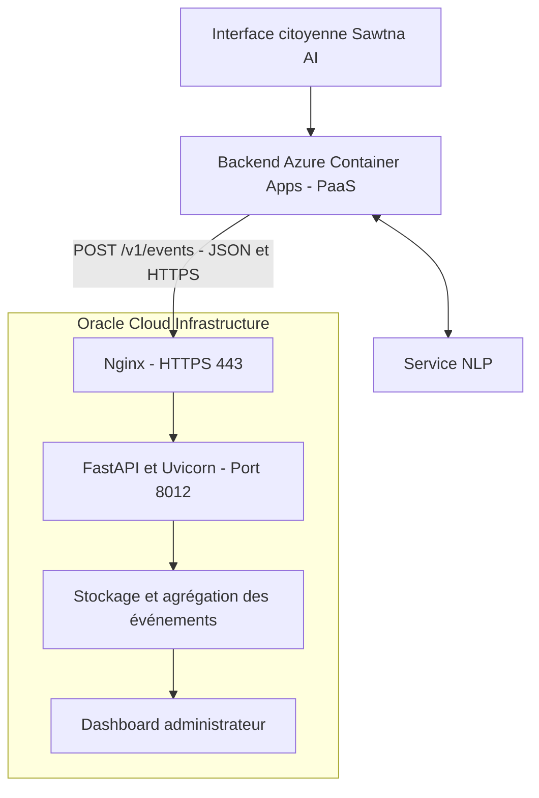

# Étudiant 5 — Analytics et tableau de bord sur Oracle Cloud Infrastructure

**Responsable :** Ijlal Sellak  
**Fournisseur cloud :** Oracle Cloud Infrastructure (OCI)  
**Modèle cloud :** Oracle Compute (IaaS)  
**Système d'exploitation :** Ubuntu 24.04 LTS  
**Objectif :** collecter les événements autorisés du backend et afficher des indicateurs opérationnels agrégés dans un tableau de bord administrateur.

## 1. Périmètre

Le service Analytics est destiné au suivi interne de la plateforme Sawtna AI et reste indépendant de l'interface citoyenne.

Il reçoit uniquement les événements définis dans le contrat Analytics commun :

`commun/packages/contracts/analytics.openapi.json`

Les événements Analytics ne contiennent ni le contenu des questions des citoyens, ni leurs identités, ni leurs adresses IP, ni leurs préférences politiques.

Le dashboard permet de suivre l'activité, les performances, la répartition linguistique et la disponibilité des services.

## 2. Services cloud et technologies utilisés

| Service / Technologie | Rôle |
|---|---|
| Oracle Compute (IaaS) | Hébergement du service Analytics sur une machine virtuelle |
| Oracle Virtual Cloud Network (VCN) | Infrastructure réseau virtuelle |
| Oracle VNIC | Interface réseau virtuelle de la machine |
| Oracle Security Lists | Contrôle du trafic réseau entrant et sortant |
| Azure Container Apps (PaaS) | Hébergement du backend principal interconnecté |
| Ubuntu 24.04 LTS | Système d'exploitation de la VM |
| FastAPI | Développement de l'API REST Analytics |
| Uvicorn | Serveur d'exécution de l'application |
| Nginx | Reverse proxy et gestion des accès HTTPS |
| DuckDNS | Résolution du nom de domaine |
| Let's Encrypt / Certbot | Obtention et gestion du certificat TLS |
| systemd | Gestion de l'exécution continue du service |
| iptables | Configuration du pare-feu Ubuntu |

## 3. Architecture technique



L'architecture repose sur la collaboration de deux fournisseurs cloud différents : Microsoft Azure et Oracle Cloud Infrastructure.

Le backend principal est hébergé sur Azure Container Apps, tandis que le service Analytics est déployé sur une machine virtuelle Oracle Compute.

## 4. Mise en œuvre de l'infrastructure Oracle Cloud

Les étapes de déploiement réalisées sont les suivantes :

1. Provisionnement d'une instance Oracle Compute.
2. Utilisation du système Ubuntu 24.04 LTS sur architecture ARM64.
3. Configuration de l'accessibilité réseau de la machine virtuelle.
4. Configuration des règles de sécurité OCI.
5. Autorisation des communications HTTP et HTTPS.
6. Connexion distante à la machine via SSH.
7. Récupération du projet et installation des dépendances Python.
8. Déploiement de l'application FastAPI avec Uvicorn.
9. Configuration de Nginx comme reverse proxy.
10. Association d'un nom de domaine avec DuckDNS.
11. Configuration du certificat TLS avec Let's Encrypt et Certbot.
12. Configuration de systemd pour maintenir le service actif.
13. Interconnexion et validation avec le backend Azure.

## 5. Configuration réseau

La machine virtuelle dispose d'une adresse IP publique permettant son accessibilité depuis les autres services cloud.

Les règles réseau sont appliquées au niveau d'Oracle Cloud et du pare-feu Ubuntu.

| Port | Protocole | Utilisation |
|---|---|---|
| 22 | SSH | Administration distante |
| 80 | HTTP | Accès HTTP et redirection HTTPS |
| 443 | HTTPS | Communication sécurisée |
| 8012 | HTTP interne | Exécution locale du service Analytics |

Le port 8012 n'est pas exposé directement sur Internet.

Nginx reçoit les requêtes publiques et les transmet à l'application exécutée sur :

`http://127.0.0.1:8012`

## 6. Interconnexion entre Azure et Oracle

Le backend principal est déployé sur Azure Container Apps (PaaS).

URL du backend :

https://sawtna-backend.victorioussand-15a060a5.polandcentral.azurecontainerapps.io

URL du service Analytics :

https://sawtna-analytics.duckdns.org

La communication entre les deux fournisseurs cloud repose sur une API REST sécurisée en HTTPS.

Le backend Azure génère un événement lorsqu'un utilisateur pose une question ou termine un quiz.

Cet événement est transmis au service Analytics via :

`POST /v1/events`

La requête est authentifiée par le header HTTP `X-Service-Key`.

La clé est configurée comme secret dans Azure Container Apps et comme variable d'environnement sur Oracle Cloud.

## 7. Flux des données

1. Le citoyen interagit avec la plateforme Sawtna AI.
2. Le backend Azure traite sa demande.
3. Le backend génère un événement Analytics au format JSON.
4. L'événement est transmis en HTTPS vers Oracle Cloud.
5. Nginx reçoit et transmet la requête à FastAPI.
6. Le service vérifie l'authentification et valide le schéma.
7. L'événement est enregistré.
8. Les statistiques sont agrégées.
9. Le dashboard administrateur récupère les indicateurs.

### Exemple d'événement

```json
{
  "event_id": "550e8400-e29b-41d4-a716-446655440000",
  "event": "question_answered",
  "language": "fr",
  "latency_ms": 1250,
  "score": 0
}
```

### Types d'événements

- `question_answered` : question ayant reçu une réponse.
- `question_unanswered` : question restée sans réponse.
- `quiz_completed` : quiz terminé.

### Langues prises en charge

- Français (`fr`)
- Arabe (`ar`)
- Darija (`darija`)

## 8. Endpoints de l'API Analytics

| Méthode | Endpoint | Fonction |
|---|---|---|
| GET | `/health` | Vérification de la disponibilité |
| POST | `/v1/events` | Réception des événements |
| GET | `/v1/summary` | Récupération des statistiques agrégées |
| GET | `/api/admin/summary` | Récupération des données administratives |
| GET | `/dashboard` | Interface du tableau de bord |

## 9. Catalogue des KPI

| Indicateur | Définition |
|---|---|
| Nombre de questions | Nombre total de questions enregistrées |
| Questions répondues | Nombre d'événements question_answered |
| Questions sans réponse | Nombre d'événements question_unanswered |
| Taux de réponse | Questions répondues / Total des questions × 100 |
| Quiz terminés | Nombre d'événements quiz_completed |
| Score moyen | Moyenne des scores des quiz concernés |
| Latence moyenne | Moyenne des latences enregistrées dans le périmètre de calcul |
| Répartition linguistique | Distribution des questions selon leur langue |
| Activité quotidienne | Évolution du volume d'activité par jour |
| Disponibilité | État des services de l'architecture |

Le taux de réponse ne représente pas directement la précision ou la qualité des réponses générées.

Les périodes, fuseaux horaires et périmètres exacts d'agrégation doivent correspondre aux règles implémentées dans le service.

## 10. Tableau de bord administrateur

Le dashboard est accessible à l'adresse suivante :

https://sawtna-analytics.duckdns.org/dashboard

Il est organisé en quatre sections principales :

- Vue d'ensemble : indicateurs clés de performance.
- Activité : évolution quotidienne de l'activité.
- Langues : répartition linguistique.
- Services : supervision de la disponibilité des composants.

L'interface est indépendante du frontend citoyen et récupère ses données depuis les endpoints Analytics.

Elle affiche également un horodatage de mise à jour des statistiques.

## 11. Sécurité et confidentialité

Les mécanismes de sécurité mis en œuvre comprennent :

- Authentification SSH par clé.
- Configuration des Security Lists Oracle.
- Configuration du pare-feu Ubuntu.
- Limitation des ports exposés publiquement.
- Utilisation de HTTPS avec un certificat TLS.
- Authentification des communications entre services.
- Protection des endpoints administratifs.
- Séparation des clés de service et d'administration.
- Minimisation des données collectées.

### Variables d'environnement

- `SAWTNA_SERVICE_KEY` : authentification des communications entre services.
- `SAWTNA_ADMIN_KEY` : authentification administrateur.
- `SAWTNA_ANALYTICS_KEY` : secret configuré côté backend Azure.

Les valeurs des clés secrètes ne doivent jamais être publiées dans le dépôt GitHub.

Le service Analytics ne consulte pas directement la base opérationnelle PostgreSQL du backend pour collecter les événements.

## 12. Exécution du service

### Exécution locale

```bash
python -m uvicorn sawtna.analytics:app --host 127.0.0.1 --port 8012 --no-access-log
```

### Exécution sur Oracle Cloud

Le service est géré par systemd sous le nom :

`sawtna-analytics`

Vérification de son état :

```bash
sudo systemctl is-active sawtna-analytics nginx
```

Consultation des journaux :

```bash
sudo journalctl -u sawtna-analytics --no-pager -n 50
```

Vérification des événements reçus :

```bash
sudo journalctl -u sawtna-analytics --since today --no-pager | grep "POST /v1/events"
```

Si les journaux applicatifs ne contiennent pas les requêtes HTTP, consulter les journaux d'accès Nginx.

## 13. Tests et validation

### Tests automatisés prévus dans le projet

```bash
python -m pytest commun/tests/test_nlp_analytics.py
```

### Tests d'intégration réalisés

| Test | Résultat |
|---|---|
| Disponibilité de l'API Analytics | HTTP 200 OK |
| Envoi d'un événement sans clé | HTTP 401 Unauthorized |
| Envoi d'un événement avec clé valide | HTTP 202 Accepted |
| Récupération des statistiques | HTTP 200 OK |
| Accessibilité HTTPS | Validée |
| Authentification administrateur | Validée |
| Communication Azure vers Oracle | Validée |
| Accessibilité depuis un réseau externe | Validée |
| Réception d'événements issus du backend | Confirmée |

### Vérification du service Oracle

https://sawtna-analytics.duckdns.org/health

Résultat attendu :

```json
{
  "status": "ok",
  "service": "analytics"
}
```

### Vérification de l'interconnexion Azure

https://sawtna-backend.victorioussand-15a060a5.polandcentral.azurecontainerapps.io/health

Résultat attendu :

```json
{
  "status": "ok",
  "service": "backend",
  "database": "postgresql+pgvector",
  "dependencies": {
    "nlp": true,
    "analytics": true
  }
}
```

## 14. Scénario de démonstration

1. Vérifier que l'instance Oracle Compute est en statut Running.
2. Vérifier que les services Analytics et Nginx sont actifs.
3. Consulter l'endpoint Health du service Oracle.
4. Consulter l'endpoint Health du backend Azure.
5. Ouvrir le dashboard administrateur.
6. Relever les indicateurs avant le test.
7. Poser une question depuis la plateforme Sawtna AI.
8. Actualiser le dashboard.
9. Vérifier la réception du nouvel événement et l'évolution des statistiques.

Ce scénario démontre concrètement la collaboration entre Azure Container Apps et Oracle Compute.

## 15. Livrables

- Service Analytics déployé sur Oracle Compute.
- API REST accessible en HTTPS.
- Dashboard administrateur indépendant.
- Infrastructure réseau configurée.
- Catalogue des indicateurs de performance.
- Mécanismes d'authentification.
- Interconnexion avec le backend Azure.
- Documentation de déploiement et d'exploitation.
- Résultats des tests d'intégration.

## 16. Critères de validation complémentaires

Les points suivants doivent être vérifiés et documentés avant la mise en production :

- Déduplication des événements à partir de leur identifiant unique.
- Idempotence de l'ingestion.
- Correspondance entre les graphiques et les formules des KPI.
- Gestion des périodes sans données.
- Politique de conservation des journaux techniques.
- Persistance des règles du pare-feu après redémarrage.
- Sauvegarde et restauration des données.
- Rotation et révocation des clés secrètes.
- Supervision de la consommation des ressources cloud.

## 17. Conclusion

Le service Analytics de Sawtna AI repose sur une infrastructure IaaS déployée sur Oracle Cloud Infrastructure et interconnectée avec un service PaaS hébergé sur Microsoft Azure.

Cette réalisation démontre la mise en œuvre d'une architecture multicloud fonctionnelle, intégrant le provisionnement des ressources, la configuration réseau, le déploiement applicatif, la sécurisation des communications et l'échange de données entre plusieurs fournisseurs cloud.

Le service est accessible indépendamment de l'ordinateur personnel de son responsable, tant que la machine virtuelle et les services associés restent actifs.

